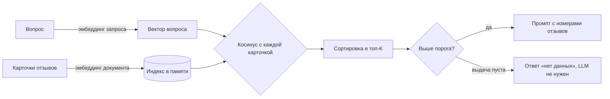

# rag-demo

[](https://github.com/LarisaRodzhanovna/rag-demo/actions/workflows/test.yml)

Прототип RAG на Go: по вопросу находит среди отзывов клиентов нужные по смыслу и собирает из них промпт для LLM. Без внешних зависимостей, только стандартная библиотека.

Работает в двух режимах:

- **офлайн**: игрушечные эмбеддинги на двух осях («про доставку» и «про еду»), без сети и без денег, можно сразу запускать;
- **с Яндексом**: настоящие эмбеддинги Yandex Foundation Models (`text-search-doc` для карточек, `text-search-query` для вопросов).

Рядом лежит [review-analyzer](https://github.com/LarisaRodzhanovna/review-analyzer): утилита, которая разбирает те же отзывы через LLM. Из этих двух кусков можно собрать «поиск по отзывам с ответом по источникам».

## Как это устроено



Номера отзывов попадают в промпт, а инструкция требует отвечать только по ним и ссылаться на номера в квадратных скобках. Если ничего не прошло порог, вызывать LLM незачем: ответ «нет данных».

## Запуск

Нужен Go 1.21 или новее.

```bash
go run .
```

Пример вывода (офлайн-режим):

```text
Эмбеддинги: игрушечные, 2 оси

=== Почему недовольны доставкой? ===
  0.999  [1] Курьер опоздал на два часа
  0.997  [5] Привезли быстро, курьер вежливый
  0.920  [2] Доставка задержалась, пицца остыла

--- промпт для LLM ---
Ты аналитик отзывов. Отвечай ТОЛЬКО по отзывам ниже.
Если ответа в них нет, напиши "нет данных".
Указывай номера отзывов в квадратных скобках.

Отзывы:
[1] Курьер опоздал на два часа
[5] Привезли быстро, курьер вежливый
[2] Доставка задержалась, пицца остыла

Вопрос: Почему недовольны доставкой?

=== Что говорят про начинку? ===
  0.999  [4] Сыра пожалели, начинки мало
  0.999  [3] Пицца очень вкусная, тесто тонкое
  0.656  [2] Доставка задержалась, пицца остыла

=== Как лечить простуду? ===
Ничего релевантного (все ниже порога 0.4) → отвечаем «нет данных», LLM не вызываем
```

Вопрос про простуду специально не по теме: он показывает ветку «нет данных».

### С настоящими эмбеддингами Яндекса

Нужны API-ключ сервисного аккаунта (роль `ai.languageModels.user`) и ID каталога. Список переменных есть в [`.env.example`](.env.example); сам `.env` программа не читает, переменные задаются в оболочке:

```powershell
$env:YANDEX_API_KEY   = "..."
$env:YANDEX_FOLDER_ID = "b1g..."
go run .
```

```bash
export YANDEX_API_KEY=... YANDEX_FOLDER_ID=b1g...
go run .
```

Эндпоинт и формат ответа Yandex AI Studio меняются, сверяйте их с актуальной документацией.

## Что где лежит

| Файл | Что внутри |
|---|---|
| `rag.go` | интерфейс `Embedder`, индекс в памяти (`Add`, `Search`), `Cosine`, `BuildPrompt` |
| `yandex_embedder.go` | `YandexEmbedder`: запрос к Foundation Models, разбор чисел, которые приходят и числами, и строками |
| `main.go` | `ToyEmbedder` и демонстрационный запуск |
| `rag_test.go` | тесты |

`Embedder` это интерфейс, поэтому смена провайдера эмбеддингов не затрагивает поиск. Параметр `Kind` (документ или запрос) нужен потому, что у Яндекса для них разные модели, а точки они кладут на одну карту.

## Тесты

```bash
go test ./...
```

Тесты не ходят в сеть. Покрыто: косинус (одно направление, перпендикуляр, противоположные, разная длина, нулевой вектор), порядок и усечение выдачи по топ-K, порог, пустая выдача для вопроса не по теме, ошибки эмбеддера с контекстом, сборка промпта. `YandexEmbedder` проверяется на подменённом HTTP-транспорте: адрес модели для документа и запроса, заголовки, разбор чисел-строк, ошибки статуса и разбора.

## Ограничения

Это прототип, и вот чего в нём нет:

- Вызова LLM нет: программа собирает и печатает промпт, ответ модели не запрашивается. Связка с `review-analyzer` это следующий шаг.
- Эмбеддинги отражают тему, а не тональность. В примере к вопросу «Почему недовольны доставкой?» попал и положительный отзыв [5] про вежливого курьера. Отсеять его должна инструкция в промпте на стороне LLM.
- Индекс живёт в памяти, поиск перебором по всем карточкам, на диск ничего не сохраняется.
- `YandexEmbedder` по умолчанию использует `http.DefaultClient` без таймаута и без ретраев, карточки эмбеддятся последовательно.
- Порог 0.4 и `topK = 3` заданы константами в `main.go` под демонстрационные данные. Для настоящих эмбеддингов их придётся подбирать заново.

## Лицензия

[MIT](LICENSE)
